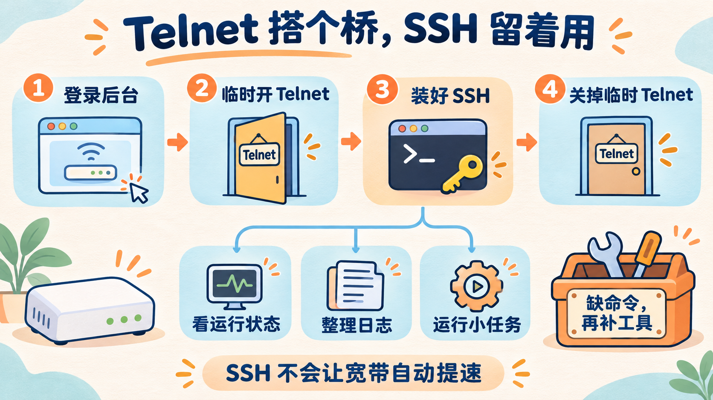
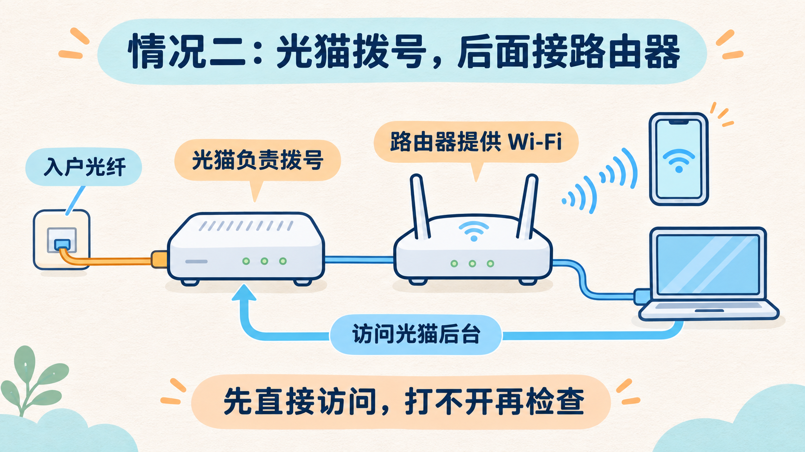

# 上海、浙江电信光猫：开启 Telnet 和 SSH 补齐shell

想让 Agent 帮你进光猫后台、开 Telnet 和 SSH，再把常用命令补齐，可以照这个流程来。先拿到自己或获准维护那台光猫的超密。

## 直接把仓库发给 Agent

把下面这段发给 Agent 就行，里面的 [Skill](skills/telecom-ont-maintenance/SKILL.md) 已经把步骤写好了。

```text
先看下这个仓库的 README.md 和 skills/telecom-ont-maintenance/SKILL.md：
https://github.com/lazyalex616/china-telecom-ont-guide

帮我看看光猫是什么型号、什么固件，现在是谁在拨号。

我想在现在的网络里直接进光猫后台，然后开 Telnet、装好 SSH，再看看常用命令缺哪些，顺便补齐。

超密我来提供，做好了告诉我以后怎么连、常用命令怎么用。
```

## 一、这次用的是哪两台光猫

| 地区 | 光猫 | 固件 |
|---|---|---|
| 上海电信 | 中兴 ZXHN G7615V2 | `V3.0.0P1T2` |
| 浙江电信·嘉兴 | ZNXT ZN-XG120 | `ZV2.01.X01` |

两台都连上 SSH 了，命令能用，自启动也配好了，还没重启试过。


### 开了以后能做什么

平时进光猫后台是在网页上点按钮，连上 Telnet 或 SSH 以后，就可以直接输命令。让 Agent 查文件、看日志、检查运行状态，都会方便一些。

这次先用 Telnet 把 SSH 装好，以后就走加密的 SSH 连接。常用命令补齐后，Agent 查东西也更顺手。



## 二、先找电信小哥要超密

可以打10000号找客服要下超密，会给你开个工单给到电信小哥，一般都会愿意给，实在不行加个微信发个红包啥的

## 三、在现在的网络里进光猫后台

这里拿 `192.168.1.1` 举例，你家光猫的地址让 Agent 看一下。

### 1. 直接用光猫上网

手机连光猫的 Wi-Fi，或者电脑直接插在光猫上，打开光猫地址就可以试着进后台。


### 2. 光猫拨号，后面接了个 Wi-Fi 路由器

宽带账号填在光猫里，后面的路由器负责给家里提供 Wi-Fi。

先直接打开光猫地址。进不去的话，让 Agent 看一下后面这台路由器的连接方式、地址和访问设置。



### 3. 光猫改了桥接，现在是路由器拨号

这种可以让 Agent 看看路由器支不支持自定义路由，也就是静态路由，把去光猫后台的请求发到接光猫的那个口。

有的路由器还要在接光猫的一侧配个地址，让光猫能把回复送回来。这部分交给 Agent 看当前配置，再把需要的设置补上。


### 拿爱快举个例子

爱快有个 [ikuai-cli](https://github.com/ikuaidev/ikuai-cli)，带配套 Skill。装到 Agent 所在的电脑上，就可以让它连路由器、看配置、改设置。

```text
我用爱快，想在现在的网络里直接进光猫后台。

先看下 https://github.com/ikuaidev/ikuai-cli，把适合我电脑的 CLI 和 Skill 装好。

连上路由器，看看现在是谁在拨号、哪个口接光猫、光猫地址是多少。

把访问光猫后台需要的路由和其他设置配好，看看能不能进。
```

用别的路由器，就把爱快换成你自己的品牌和型号。

## 四、让 Agent 走 CGI 登录后台

CGI 是网页服务器把请求交给后台程序处理的一种接口。你填账号、点登录，浏览器会发出登录请求；Agent 照着网页的请求流程来，也能登录并读取后台页面。

```text
帮我按光猫网页实际使用的 CGI 或其他请求流程登录后台，超密我来提供。

看一下登录请求怎么发、页面怎么跳转、登录状态怎么保存。

进去后告诉我光猫型号、固件和拨号方式，卡在哪一步就接着查那一步。
```

## 五、开启 Telnet 和 SSH

这次上海的中兴走临时维护认证，嘉兴的 ZNXT 在后台开 Telnet。进去以后，把 **Dropbear** 装到光猫自带的 SAF 应用环境里，后面就从这里连 SSH。

```text
后台已经进去了，接着帮我开 Telnet 和 SSH。

按这台光猫的型号和固件找到 Telnet 开法，连进去看看。

看看 CPU 是什么架构、程序能放在哪，把合适的 Dropbear 装进应用环境，配好 SSH 登录和自启动。

连一次 SSH，试一下命令，做好了告诉我以后怎么连。
```

SSH 能用了，就把这次临时开的 Telnet 关掉。

## 六、补齐 shell 常用命令

光猫里有些常用命令可能没带，可以用 **BusyBox** 补上。它把一批文件查看、文字处理和状态检查工具放在一个程序里，装好后 Agent 查文件、整理日志会方便一些。

这次中兴补了一份新的 BusyBox，ZNXT 自带的命令已经够用。

```text
帮我看看 shell 里查看文件、整理日志、检查状态的命令够不够用。

缺的话补一份合适的 BusyBox，单独找个目录放好，把常用命令配上。

试一下这些命令，告诉我以后怎么用。
```

---

[参考项目和许可](THIRD_PARTY_NOTICES.md) · [MIT 许可证](LICENSE)
