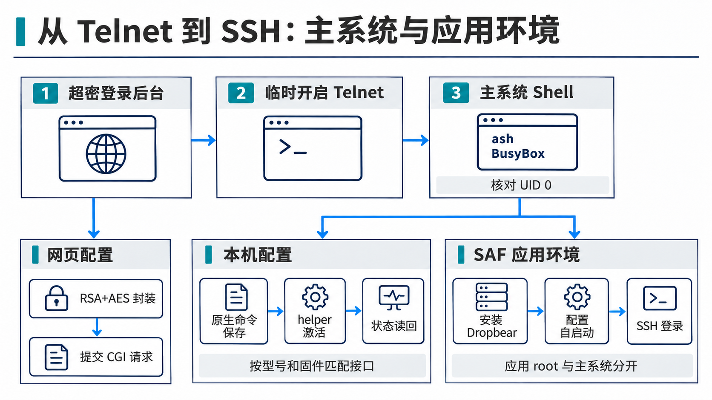

# 上海、浙江电信光猫：开启 Telnet 和 SSH 补全Shell

让Agent帮你进光猫开Telnet和SSH再补全Shell，要先拿到光猫超密

## 直接把仓库发给 Agent

把下面这段发给 Agent 就行，里面的 [Skill](skills/telecom-ont-maintenance/SKILL.md) 已经把步骤写好了。

```text
先看下这个仓库的 README.md 和 skills/telecom-ont-maintenance/SKILL.md：
https://github.com/lazyalex616/china-telecom-ont-guide

帮我看看光猫是什么型号、什么固件，现在是谁在拨号。

帮我进光猫开Telnet和SSH再补全Shell。超密我来提供，做好了告诉我怎么连、怎么用。

Telnet连进去以后，先拿到主系统root Shell，看看CPU、固件和SAF应用环境，再装SSH。要改配置的话，先看网页的RSA+AES参数怎么封装，也看看有没有现成的原生命令。需要native-ABI helper时，先对上这台固件的接口，改完把保存值和当前状态都读回来。
```

## 一、这次用的是哪两台光猫

| 地区 | 光猫 | 固件 |
|---|---|---|
| 上海电信 | 中兴 ZXHN G7615V2 | `V3.0.0P1T2` |
| 浙江电信·嘉兴 | ZNXT ZN-XG120 | `ZV2.01.X01` |

两台都连上 SSH 了，命令能用，自启动也配好了，还没重启试过。


### 开了以后能做什么

平时进光猫后台是在网页上点按钮，连上 Telnet 或 SSH 以后，就可以直接输命令。让 Agent 查文件、看日志、检查运行状态，都会方便一些。

这次先用 Telnet 把 SSH 装好，以后就走 SSH 连接。补全Shell 后，Agent 查文件、整理日志也更顺手。


## 二、先找电信小哥要超密

可以打10000号找客服要下超密，会给你开个工单给到电信小哥，一般都会愿意给，实在不行加个微信发个红包啥的

## 三、让 Agent 走 CGI 登录后台

CGI 是网页服务器把请求交给后台程序处理的一种接口。你在网页上填超密、点登录，浏览器就会把请求发给光猫。让Agent照这个流程来，就能进后台看配置。

```text
帮我看看光猫后台怎么登录，按网页的请求流程走，超密我来提供。

看一下登录请求怎么发、页面怎么跳转、登录状态怎么保存。

进去后告诉我光猫型号、固件和拨号方式，卡在哪一步就接着查那一步。
```

## 四、开启 Telnet 和 SSH

这里要让Agent把过程做全：开Telnet、拿到主系统root Shell、分清应用环境，再把SSH装好。不是看到能输命令，就算拿到整台光猫的主系统了。

### 先用Telnet进主系统

中兴这台用的是`webFac v3`临时维护入口，要用光猫超密完成登录，再拿返回的临时账号连Telnet。ZNXT这台先在后台开Telnet，用对应的命令行账号登录，需要的话再用管理员账号执行`su`。进去后让Agent用`id`核对是不是`UID 0`，也就是root，再看CPU架构、主系统和当前进程环境。

两台的登录字段、换行方式和中兴的`re_rand`处理不一样，具体步骤放在[主系统Shell和原生配置](skills/telecom-ont-maintenance/references/native-shell-config.md)里，Agent可以接着照做。

### 改配置有网页和本机两条路

中兴网页提交配置时，会把参数做RSA+AES封装。让Agent走网页这条路，就要照页面上的JavaScript处理会话、参数和加密，不能把明文表单直接发过去。

已经进了主系统root Shell，就可以再看固件自带的命令和配置接口。比如这次用`sendcmd`改日志配置、保存，再用一个小的**native-ABI helper**启用当前的原生日志发送程序。说白了，helper就是按这台固件内部的调用格式，调一下现成的功能。

这样可以不经过网页那层RSA+AES参数封装，直接从本机处理配置，但不是绕过登录认证。**保存配置和当前生效也要分开看**，网页返回成功、命令没报错，都还要把值读回来，再看实际日志有没有到NAS。

这次helper只核对过中兴`ZXHN G7615V2 / V3.0.0P1T2`的日志接口，不是改什么配置都能用。对应的请求结构、源码和编译方式也放在[详细步骤](skills/telecom-ont-maintenance/references/native-shell-config.md#四用native-abi-helper启用当前日志发送)里。

### 再把SSH装进应用环境

这两台光猫都自带SAF应用环境。让Agent从主系统找到它，把合适架构的Dropbear装进去，放好公钥、生成主机密钥，再用原生启动方式配好自启动。

这次SSH连进去是**应用环境里的root**，和前面Telnet进去的**主系统root Shell**不是一回事。要查主系统进程、改原生配置，先让Agent确认当前在哪个环境里。



```text
后台已经进去了，接着帮我开 Telnet 和 SSH。

先看仓库里的 skills/telecom-ont-maintenance/SKILL.md 和 skills/telecom-ont-maintenance/references/native-shell-config.md，按这台光猫的型号和固件开Telnet。连进去用id核对UID 0，拿到主系统root Shell，再看CPU、现有命令和SAF应用环境。

如果要改配置，别只停在网页点按钮。中兴网页用了RSA+AES封装，走CGI就照网页实际的参数和会话流程来；从主系统操作的话，先找固件自带的命令和配置接口。需要native-ABI helper时，先核对型号、固件、调用约定和数据结构，再处理指定的那项配置，保存后把当前状态也读回来。

把合适架构的Dropbear装进现有SAF应用环境，配好SSH、公钥和自启动。分别记清主系统root Shell和应用root能看到什么，不要把应用环境当成主系统。

连一次SSH，试一下命令。改了配置的话，把修改前后、保存状态和实际效果告诉我。做好了记下以后怎么连，再把这次临时开的Telnet关掉。
```

两台都验证过SSH登录，自启动已配置，还没重启试过。

## 五、补全Shell

这次两台光猫都用上了ash和 **BusyBox 1.38.0**，带 **409个工具**，又补了抓包、测速、查连接、看进程、处理JSON这些工具。程序按需使用，平时排查问题、跑点轻量任务都方便一些。

### 补全的Shell有哪些：

1. BusyBox 1.38.0 - 把ash、文件操作、文字处理、网络检查和对时等409个工具放在一起。
2. tcpdump - 抓取网口上的数据包，看看请求有没有发出去、回复有没有回来。
3. mtr - 持续查看沿途每一跳的延迟和丢包，排查网络卡在哪一段。
4. iperf3 - 测设备之间的实际网络吞吐，检查UDP丢包。
5. curl8 - 测试HTTP、HTTPS接口，读取页面和接口返回的数据。

<details>
<summary>展开完整Shell工具清单</summary>

- BusyBox 1.38.0 - 提供ash、文件操作、文字处理、网络检查、对时等409个工具。
- tcpdump 4.99.7 - 抓取和分析网口收发的数据包。
- iperf3 3.22 - 测试设备之间的网络吞吐和UDP丢包。
- ethtool 7.2 - 查询网口速率、双工模式和驱动提供的统计信息。
- strace 7.3 - 跟踪程序打开了什么文件、建立了什么连接、卡在哪一步。
- mtr 0.95 - 持续显示到目标地址沿途每一跳的延迟和丢包。
- iftop - 实时查看各个连接占用的带宽。
- bmon 4.0 - 按网口查看实时流量和数据包统计。
- socat 1.8.1.3 - 调试不同类型的连接，进行临时端口转发和数据收发。
- curl8 8.22.0 - 访问HTTP、HTTPS接口，单独使用新版功能，保留厂商原有curl。
- dig（BIND 9.20.30） - 查询DNS记录，查看服务器返回的详细解析结果。
- ip-full（iproute2 6.11.0） - 查看和处理网卡地址、路由、策略路由等网络配置。
- ss（iproute2 6.11.0） - 查看TCP、UDP连接和监听端口。
- htop 3.5.3 - 交互查看进程及CPU、内存占用。
- lsof 4.99.3 - 查看进程打开的文件和网络连接。
- jq 1.8.1 - 筛选、提取和整理JSON数据。

`arping`等命令已经包含在BusyBox里，不重复算作额外安装的软件包。`ethtool`能查询哪些信息取决于厂商驱动，本次部分查询会返回`Not supported`。

</details>

### 补全Shell可以：

1. **查文件、筛日志、改文件、查网络、跑脚本、处理日志……**
2. **让光猫跑一些轻量的自定义任务。** 比如定时检查网络、收集设备状态、转发日志、检查接口返回结果，需要什么就调用对应的工具。
3. **继续研究对应机型的固件和界面。** 比如[部分华为移动定制光猫切换公版界面](https://www.right.com.cn/forum/thread-4060870-1-1.html)的案例。换界面有时只是切换定制配置，不等于换了整个系统；这次两台光猫没有验证可用的替代系统，这部分只作为拓展阅读。

具体怎么选程序、处理运行库和检查工具，放在[补全Shell安装记录](skills/telecom-ont-maintenance/references/shell-toolkit.md)里。

```text
先看 skills/telecom-ont-maintenance/SKILL.md 和 skills/telecom-ont-maintenance/references/shell-toolkit.md，帮我看看Shell要不要补全。

先核对主系统和应用环境里的BusyBox、CPU架构、运行库、剩余内存和空间，再按我需要的功能补工具。参考这次的BusyBox 1.38.0和工具清单，已有的能用就沿用。

需要用OpenWrt软件包里的工具，就把程序和运行库单独放好，别直接往厂商opkg里装。厂商原有curl保留，新版用curl8。补好后按实际网络条件检查，告诉我装了什么、怎么调用、哪些功能还受驱动和网络条件限制。
```

---

[参考项目和许可](THIRD_PARTY_NOTICES.md) · [MIT 许可证](LICENSE)
