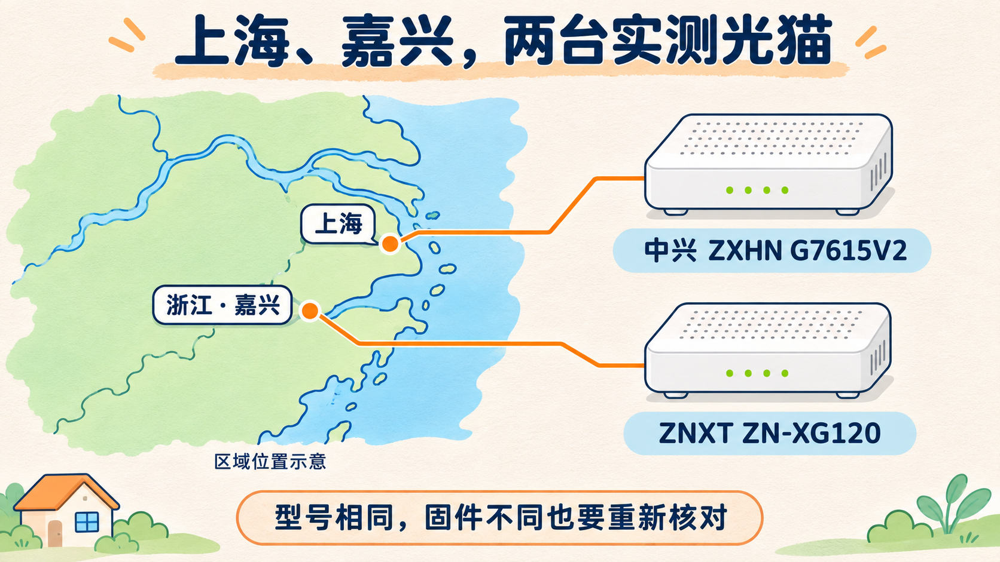
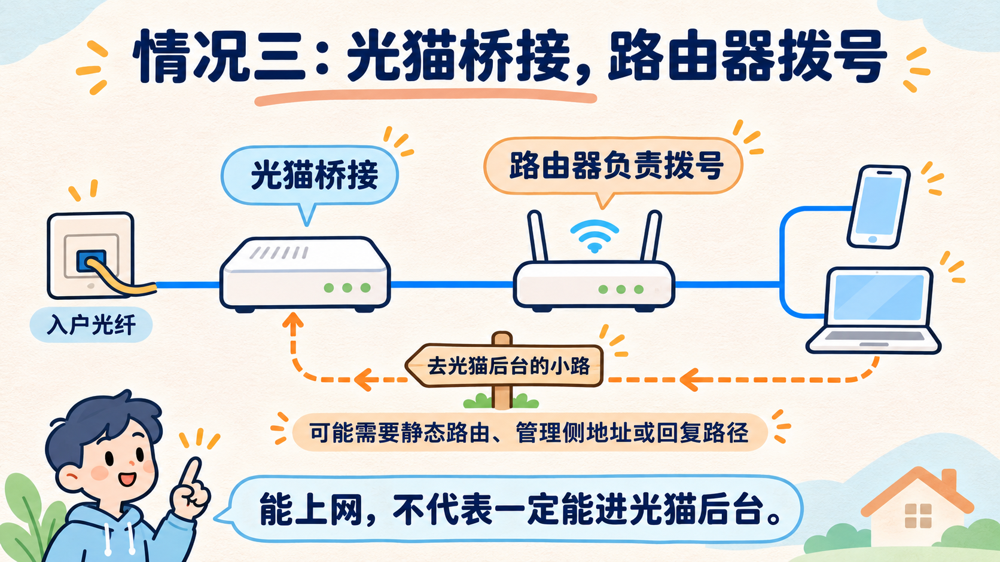

# 上海、浙江电信光猫：让 Agent 帮你开 SSH，顺便补齐常用命令

想折腾一下自家的光猫，又不想挨个研究命令，可以把事情交给 Agent。

这篇就讲这么一条路：**先连上光猫后台，再临时开 Telnet，装好 SSH，最后看看有没有需要补的命令。**

这里的 Agent，指能在你的电脑上执行命令、访问家里网络的 AI 助手，不是只能聊天的网页问答工具。

不需要为了这个教程改桥接，也不用照搬别人家的网络。你现在怎么上网，就尽量保持怎么上网。

### 懒得逐段复制？整份交给 Agent 就行

仓库里有一份 [总 Skill](skills/telecom-ont-maintenance/SKILL.md)，把下面这段发给 Agent，让它先读教程和 Skill，再帮你做。能读取仓库文件就可以开始了解流程，不必先研究怎么安装 Skill。

```text
帮我按这个仓库维护自己的光猫：
https://github.com/lazyalex616/china-telecom-ont-guide

先读 README.md 和 skills/telecom-ont-maintenance/SKILL.md，按 Skill 的步骤来。

我的目标是：从现在的家庭网络连上光猫后台，通过临时 Telnet 装好 SSH，再按需要补齐常用命令。

先核对型号、固件、谁在拨号，以及现有管理路径。超密我会安全提供，不要猜密码。

需要装工具或改设备时，先把具体方案告诉我，我确认以后再做。别改现有拨号，别刷机、恢复出厂或擅自重启，也别把管理入口开到公网。

做好以后，用大白话告诉我现在能用什么、临时 Telnet 有没有关，以及重启恢复有没有真的验证过。
```

## 一、这次折腾的是哪两台？

| 地区 | 光猫 | 测试时的固件 |
|---|---|---|
| 上海电信 | 中兴 ZXHN G7615V2 | `V3.0.0P1T2` |
| 浙江电信·嘉兴 | ZNXT ZN-XG120 | `ZV2.01.X01` |

这两台都已经成功连上 SSH，能登录、能执行命令。自启动也配好了，但还没实际重启验证。

换句话说，**目前能用，不等于已经证明重启以后也一定能用。** 别的型号、别的固件，也不能直接照抄。



配图由 GPT 生成，都是帮助理解的示意图，不是真实设备照片，也不是额外的实测证据。

### 开 Telnet、SSH 有啥用？

平时进光猫后台，是在网页上点按钮。连上 Telnet 或 SSH，就能直接输命令，让 Agent 看一些网页里看不到的东西。

比如查看运行状态、处理日志，或者做一些你明确交代的小任务。

这次 **Telnet 只是用来搭个桥，SSH 装好以后就把临时 Telnet 关掉**。以后维护优先用 SSH，连接过程有加密，也更方便交给 Agent。

当然，这不是宽带提速教程。开了 SSH，网速不会凭空涨一截。


## 二、先把超密要到手

先别急着下工具，第一件事是拿到自己这台光猫的超密，也就是超级管理员账号和密码。

可以先打 **10000 号**，跟客服说想要自己光猫的超密，请他们开个工单、转给装维处理。等电信小哥联系你了，就试着问他要一要。

要是不好要，可以加个微信再聊聊，愿意的话发个小红包表示感谢也行。不过各地情况不一样，不保证一定拿得到；对方明确说不能提供，就再跟客服沟通。

注意，你要的是**当前这台光猫能用的超密**，不是 Wi-Fi 密码，也不一定是光猫背面贴的那个普通管理密码。

这里只聊自己的光猫，或者机主明确允许你维护的设备。没拿到有效超密，就先停在这，不猜密码。

拿到以后，自己收好，通过安全方式交给 Agent。别把密码贴到公开仓库里，也别让它为了省事写进脚本。

## 三、进光猫后台，不一定要拔网线、改电脑 IP

先看看你家是哪种情况。能直接打开后台，就不用多折腾。

下面的 `192.168.1.1` 只是常见地址举例，不一定是你家光猫的地址。

### 1. 直接用光猫上网，后面没接路由器

比如手机连着光猫的 Wi-Fi，或者电脑直接插在光猫上。

这种最省事。你已经在光猫的网络里，通常直接打开它的管理地址就行，不用先给电脑手动配 IP。


### 2. 后面接了 Wi-Fi 路由器，但还是光猫拨号

也就是宽带账号填在光猫里，后面的路由器负责给家里提供 Wi-Fi。

这时通常也能直接访问光猫后台。如果后面的设备只是当无线接入点用，那就更简单。

先试着打开光猫的管理地址。打不开，再让 Agent 看看是不是地址撞车了，或者路由器挡住了访问，没必要上来就改桥接。


### 3. 光猫改了桥接，现在是你的路由器拨号

这种就可能需要补一下路。

说白了，**路由器知道怎么带你上网，但不一定知道怎么带你去光猫后台。**

如果路由器支持自定义路由，也叫静态路由，就可以告诉它：

> 去光猫管理地址的请求，走接光猫的那个口。

有些路由器还要给接光猫的一侧配个管理地址，让光猫知道怎么把回复送回来。所以不一定加一条路由就完事，得看你的设备支持什么。



#### 拿爱快举个例子

爱快有个 [ikuai-cli](https://github.com/ikuaidev/ikuai-cli)，可以让 Agent 用命令管理路由器，还带配套 Skill。

把工具装在运行 Agent 的电脑上就行，不是装到光猫里。

可以直接跟 Agent 说：

```text
我用的是爱快路由器，想从现在的家庭网络直接访问光猫后台，不想每次拔网线、直连光猫、手动改电脑 IP。

先去看一下 https://github.com/ikuaidev/ikuai-cli，按我的电脑系统装好 CLI 和配套 Skill，确认我的路由器版本能用。

用我安全提供的凭据连接路由器，先看看现在是谁在拨号、哪个口接光猫，以及光猫的实际管理地址。

已经能访问就别改。不能访问的话，看看要不要补静态路由、管理侧地址，或者处理光猫的回复路径。

先告诉我具体准备改什么，我确认以后再动。别改现有拨号、默认上网路由或连接配置，也别把后台开放到公网。
```

不是爱快也没关系，把路由器名称换成你自己的，让 Agent 先查它支持什么。

以前很多人执着于让路由器拨号，觉得它转发性能更强。不过现在不少光猫也不弱，普通家庭够用就行。**这篇是给爱折腾的人提供一条思路，不是劝所有人改桥接。**

## 四、让 Agent 通过 CGI 连上后台

### CGI 是个啥？

不用记全称。在这里，把它理解成**网页背后接单办事的入口**就行。

你填账号、点登录，浏览器会把请求发给后台。Agent 也可以照着这个流程发请求、拿结果，不一定要替你找按钮、点页面。

但它不是免密入口，账号、密码、权限一样不能少。

把这段发给 Agent：

```text
帮我连上自己光猫的管理后台，优先按网页实际使用的 CGI 请求流程来。

超密我已经从电信小哥那里拿到了，会通过安全方式提供给你。先确认地址对应的是我的光猫，再提交密码。

看看它真正的登录流程是什么，包括跳转和登录状态。中兴和 ZNXT 的流程可能不一样，别拿另一款光猫的方法直接套。

进去以后，先告诉我品牌、型号、固件，以及现在是谁在拨号。别顺手改设置。

如果浏览器能登录，你却进不去，先检查流程和会话，别一直试密码。也别拿到了登录页，就说自己已经进后台了。

不要打印密码或登录凭证，也不要重启、导出配置。
```

这一步先做到**认对设备、真正登录进去**，就够了。

## 五、再通过 Telnet 把 SSH 装起来

不是每台光猫都有一个“开启 SSH”的按钮。

我们这两台走的是：先通过匹配固件的临时 Telnet 维护入口进入命令行，再把一个小型 SSH 程序装进光猫已有的可写应用区域。用的程序叫 **Dropbear**，不用刷机。

还有一点：**后台超密不一定也是 Telnet 密码。** 如果还缺别的凭据，就先取得，别让 Agent 猜。Telnet 的连接不加密，只在可信的管理网络里临时使用。

继续跟 Agent 说：

```text
后台已经连上了，接下来帮我看看这台光猫能不能通过临时 Telnet 安装 SSH。

先核对型号和固件，找匹配的维护方法。中兴样本用的是临时维护认证，ZNXT 样本是在后台临时打开 Telnet，别互相照搬。

如果还缺 Telnet 或管理员凭据，先告诉我，不要猜密码、绕权限。

看看现在有没有 SSH，以及程序能保存在哪里。已有的服务、文件别覆盖。

先告诉我准备装什么、放在哪里、怎么启动，我确认后再做。程序要来自可信来源，而且得适合这台光猫的 CPU。

SSH 用密钥登录，私钥留在电脑上，只把公钥放到光猫。只供可信内网使用，不开公网入口或转发功能。

实际连上 SSH、确认命令能执行以后，把这次临时开的 Telnet 关掉，并确认已经关闭。

别刷机、恢复出厂或重启，也别动拨号、光路注册、电视和电话配置。最后说清楚当前能不能用，以及重启恢复有没有真的验证过。
```

连上以后，也别看到 `root` 就以为整台光猫都随便你用了。

**有些 SSH 进去的只是光猫里的应用区域。** 能看哪些文件、哪些进程、哪些日志，还得让 Agent 分别确认。我们这两台就是这种情况。

## 六、命令不够用，再补个工具箱

能进命令行，不代表里面什么工具都有。

Agent 想查个文件、筛一下日志，结果发现命令不存在，就会卡住。这时可以按需要补充 **BusyBox**，把它当成装了很多小工具的工具箱就行。

这里说的“补全 Shell”，主要就是补齐常用命令，不是破解权限，也不是给光猫换系统。

这次中兴样本补了较新的 BusyBox，原来的工具照样保留。ZNXT 样本自带的命令已经挺齐，就没必要再装一套。

可以跟 Agent 说：

```text
再帮我看看这台光猫的常用命令够不够用，主要是查看文件、整理日志、检查运行状态这些。

已经有的就用现成的，别为了“补全”再装一遍。

确实缺命令的话，告诉我缺什么、补上能解决什么。需要 BusyBox 时，核对来源和 CPU 是否匹配。

新增工具放在独立目录，别覆盖原来的 BusyBox、Shell 和厂商命令。先列给我看，我确认后再安装。

装好以后验证一下能不能用，再说清楚哪些只是当前有效、哪些已经保存，以及重启后恢复有没有验证。

别为了补几个命令去改固件、分区，也别顺手停掉其他服务。
```

补齐以后，Agent 查东西会顺手一些，少绕几次路。但它不会自动帮你转发日志，也不会自动保证重启以后还在。

先把 SSH 和需要的命令弄好就可以收工。后面想做什么，再一件件交代，没必要一次把光猫改个遍。

---

[来源与第三方说明](THIRD_PARTY_NOTICES.md) · [MIT 许可证](LICENSE)
