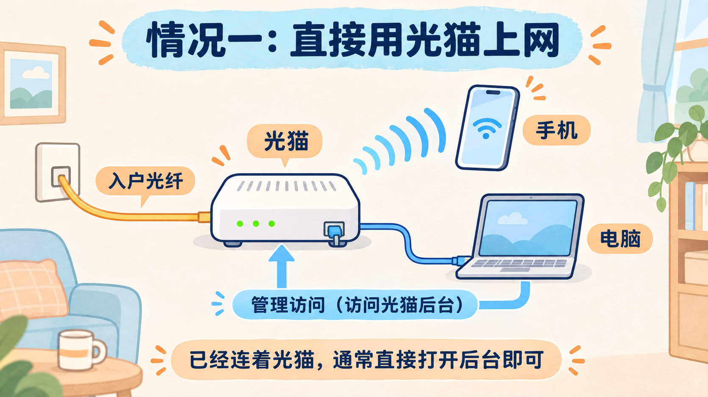

# 上海、浙江电信光猫：开启 Telnet 和 SSH 补齐shell

本教程介绍如何让 Agent 登录光猫后台、开启 Telnet 和 SSH，以及补齐 shell 常用命令。

开始前，准备好本人或已获授权光猫的当前有效超密。下面的步骤由能够执行命令、访问家庭网络的 Agent 完成。

## 直接交给 Agent 使用

将以下提示词和仓库地址发给 Agent，即可按 [总 Skill](skills/telecom-ont-maintenance/SKILL.md) 开始处理。

```text
请阅读这个仓库的 README.md 和 skills/telecom-ont-maintenance/SKILL.md：
https://github.com/lazyalex616/china-telecom-ont-guide

帮我完成以下步骤：
1. 确认光猫型号、固件、拨号方式和管理地址。
2. 从当前家庭网络登录光猫后台。
3. 开启 Telnet，安装并启用 SSH。
4. 按需要补齐 shell 常用命令。

超密由我提供。完成后，记录连接方式、安装目录和常用命令的使用方法。
```

## 一、测试设备和功能用途

| 地区 | 品牌和型号 | 测试时的固件 |
|---|---|---|
| 上海电信 | 中兴 ZXHN G7615V2 | `V3.0.0P1T2` |
| 浙江电信·嘉兴 | ZNXT ZN-XG120 | `ZV2.01.X01` |

已完成：应用环境 SSH 登录、命令执行和自启动项配置。待验证：重启后恢复。


配图为设备外观与操作流程的非实拍示意。

### Telnet、SSH 和 shell 分别做什么？

- **Telnet**：通过命令行连接光猫，用于初次配置。
- **SSH**：提供加密的命令行连接，便于后续登录和维护。
- **shell**：接收并执行命令的程序。补齐常用命令后，可以更方便地查看文件、整理日志和检查运行状态。


## 二、获取光猫超密

超密指光猫的超级管理员账号和密码。

可以拨打 **10000 号**，向客服说明想获取光猫超密，请客服开工单转交装维。等电信小哥联系后，再说明需求并索取当前有效的账号和密码。

也可以加微信继续沟通，个人愿意的话可以用小红包表达感谢。取得超密后，通过自己的凭据管理方式提供给 Agent。

## 三、从家庭网络访问光猫后台

`192.168.1.1` 是常见的光猫管理地址示例，实际地址以设备配置为准。

### 1. 直接使用光猫上网

手机连接光猫 Wi-Fi，或电脑通过网线连接光猫后，打开光猫管理地址即可尝试访问后台。



### 2. 光猫拨号，后面连接 Wi-Fi 路由器

宽带账号配置在光猫上，后级路由器为家里的设备提供网络和 Wi-Fi。

先从当前网络打开光猫管理地址。Agent 可以结合后级路由器的连接模式、内网地址和访问规则，检查这条管理路径。


### 3. 光猫桥接，由路由器拨号

这种情况下，Agent 可以查看路由器连接光猫的接口，为访问后台配置管理路径。

静态路由用于指定管理请求的出口；管理侧地址和回复路径配置用于完成双向通信。具体采用哪种组合，由路由器的现有配置和功能决定。


### 以爱快为例

爱快提供了 [ikuai-cli](https://github.com/ikuaidev/ikuai-cli) 和配套 Skill，可以安装在运行 Agent 的电脑上，用于读取和修改路由器配置。

```text
我使用爱快路由器，希望从当前家庭网络直接访问光猫后台。

请阅读 https://github.com/ikuaidev/ikuai-cli，安装适合我电脑系统的 CLI 和配套 Skill。

连接路由器，查看拨号方式、连接光猫的接口、光猫管理地址和现有路由。

根据当前配置，为光猫后台建立管理访问路径，完成访问验证并记录所做的配置。
```

使用其他路由器时，将提示词中的爱快替换成自己的品牌和型号即可。拨号方式可以根据设备性能和功能需求选择，本教程沿用当前网络结构。

## 四、通过 CGI 登录后台

**CGI（Common Gateway Interface，通用网关接口）是 Web 服务器将请求交给后台程序处理的一种机制。**

在浏览器中提交账号和密码后，后台程序会处理登录请求并返回结果。Agent 可以沿用网页实际使用的请求流程，处理跳转、登录状态和后续页面读取。

```text
请根据光猫网页实际使用的 CGI 或其他 Web 请求流程登录后台。

读取登录入口，处理表单提交、页面跳转和登录会话。超密由我提供。

登录后，读取品牌、型号、固件和当前拨号方式。遇到登录问题时，检查请求字段、跳转、会话和权限状态。
```

## 五、开启 Telnet 和 SSH

两台样本采用的流程是：先通过对应固件的维护方法开启 Telnet，再在光猫已有的 SAF 应用环境中安装并启用 **Dropbear SSH 服务**。

中兴样本使用临时维护认证，ZNXT 样本通过后台开启 Telnet。Agent 可以根据当前设备情况完成登录、安装和启动配置。

```text
后台已经登录，请继续开启 Telnet 和 SSH。

根据型号和固件确定 Telnet 开启方式，使用相应凭据进入命令行。

检查 CPU 架构、可写存储和现有应用环境，选择对应的 Dropbear 程序，完成 SSH 安装、认证和自启动配置。

验证 SSH 登录和命令执行，记录连接方式及安装位置。
```

SSH 登录位置为光猫的 SAF 应用环境。完成 SSH 验证后，关闭本次临时开启的 Telnet。

## 六、补齐 shell 常用命令

**BusyBox** 将文件查看、文字处理和状态检查等多种命令集中在一个程序中，可用于补充光猫的常用工具。

中兴样本补充了较新的 BusyBox；ZNXT 样本使用已有命令。

```text
请检查 shell 中用于查看文件、整理日志和检查运行状态的常用命令。

根据需要补充 BusyBox，在独立目录安装工具并配置命令入口。

验证相关命令，记录程序目录、调用方式和使用示例。
```

---

[来源与第三方说明](THIRD_PARTY_NOTICES.md) · [MIT 许可证](LICENSE)
