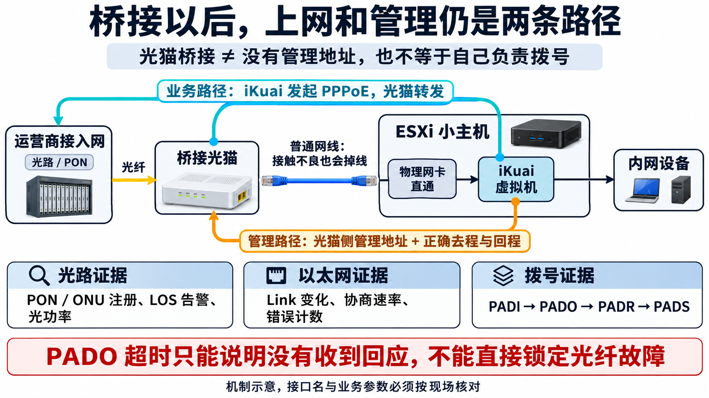
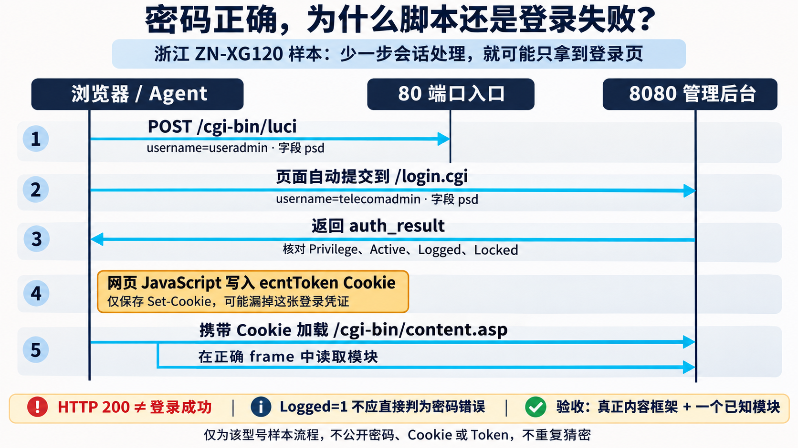
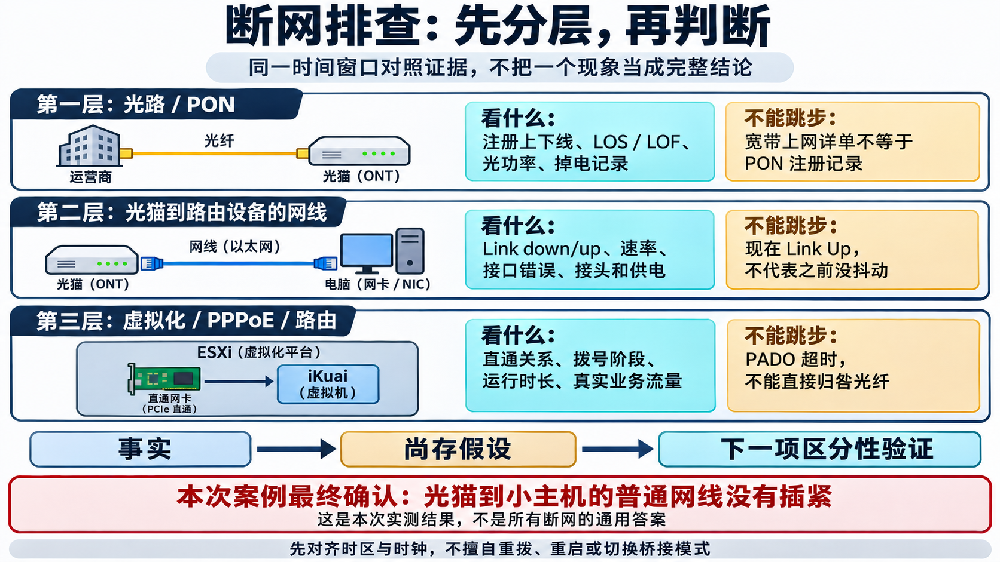
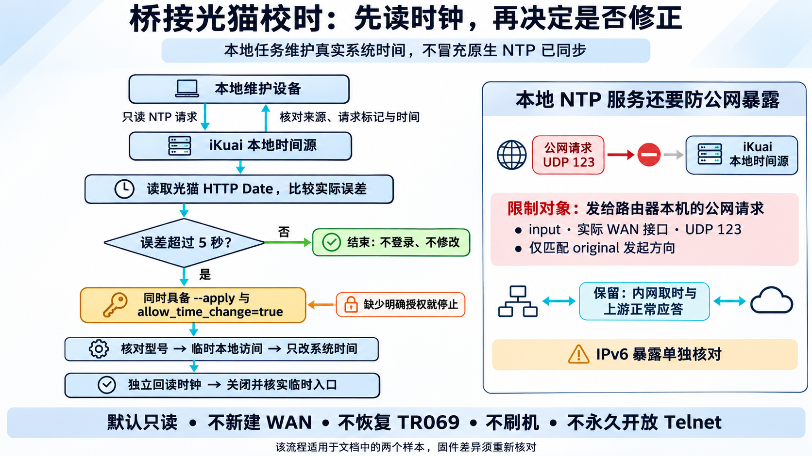

# 中文技术图与文字等价说明

这四张图由 GPT 画图工具生成，实际输出均为 **1672 × 941 像素**。发布前逐图核对过中文、主要协议字段、箭头含义和隐私，不使用真实设备截图或身份数据。

图是解释机制的辅助材料，不是新的测试结果，也不代表运营商统一标准。下面的文字提供可检索、可复制的等价说明。需要精确协议细节时，以对应章节和当前设备为准。

## 1. 桥接业务与管理路径

- 物理路径是运营商、光纤、光猫、普通网线、直通网卡、iKuai、内网。
- 案例由 iKuai 发起 PPPoE，光猫负责相关桥接转发。
- 本地管理需要正确的光猫侧管理地址、去程和回程，不能拿 PPPoE 会话是否正常替代管理路径判断。
- PPPoE 发现过程是 `PADI → PADO → PADR → PADS`，PADO 超时不直接指出光纤故障。
- ESXi 管理网卡与直通给 iKuai 的物理网卡不是同一证据来源。

详见 [网络结构](../../docs/01-before-you-start.md)。

## 2. 登录会话

- 80 端口入口与 8080 后台是浏览器两段请求，不是服务器替你自动完成全部会话。
- 本样本实际密码字段名是 `psd`。
- `ecntToken` 可能由网页 JavaScript 写为 Cookie，单独记录 `Set-Cookie` 响应头可能漏掉。
- 先核对认证分支，再加载内容框架和模块，HTTP 200 本身不证明登录成功。
- 不公开令牌，不用 `Logged=1` 直接判定密码错误。

详见 [登录流程](../../docs/02-login-and-sessions.md)。

## 3. 断网证据

- 光路看 PON/ONU 注册、LOS/LOF、光功率及掉电证据。
- 以太网看 Link 变化、速率、错误、接头和供电。
- 虚拟化和拨号看真实接口映射、运行时长、发现与会话阶段及真实业务负载。
- 上网详单不直接等于光路注册记录，当前 Link Up 不排除之前抖动。
- 本次实际故障是普通网线未插牢，不应推广成所有断网的答案。

详见 [断网取证](../../docs/06-dropouts-and-evidence.md)。

## 4. 校时和 NTP 边界

- 流程图表示本地维护程序的执行顺序，所有读取动作都由它发起。
- 默认只读取本地 NTP 和光猫 HTTP 时间，误差不大不登录、不修改。
- 普通修复需同时有 `--apply` 与本机 `allow_time_change=true`；`--force` 是独立的显式修复选项。
- 实际改动只针对光猫系统时间，随后回读并核实本次临时访问关闭。
- 路由器本地 NTP 服务还要限制真正公网接口进入、发给本机的 UDP 123 请求。
- 匹配原始连接方向是为了不误挡上游正常应答，IPv6 需单独核对。
- 真正时间正确不等于原生 NTP 同步标志已经变为成功。

详见 [校时方法](../../docs/05-time-sync.md)。
