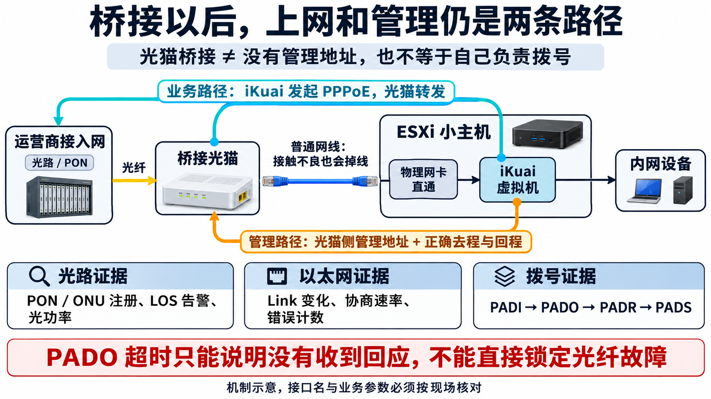

# 01：先弄清前提、超密和网络结构

[返回首页](../README.md)

## 第一步：先找宽带小哥要什么

你要的是**当前这台光猫的超级管理员账号和密码**，通常账号叫 `telecomadmin`，但不能假定所有地区都一样。

它和下面这些东西不是一回事：

| 东西 | 是干什么的 | 能不能代替超密 |
|---|---|---|
| 光猫背面的普通管理密码 | 进入普通用户页面 | 通常不能 |
| Wi-Fi 密码 | 手机连接无线网络 | 不能 |
| 宽带拨号账号密码 | iKuai 或光猫向运营商拨号 | 不能 |
| LOID、光猫 SN 等 | 光路注册和设备识别 | 不能，而且不要乱改 |
| Telnet 登录密码 | 本机命令行访问 | 也不一定和超密相同 |

可以这样和装维师傅说：

> 我是这条宽带的机主，想维护自己的光猫。麻烦提供当前设备有效的超级管理员账号和密码，并确认对应的是这台设备。我只调整已确认的桥接和本地管理设置，不改光路注册身份。如果有远程更新密码的情况，请帮忙核对当前值。

如果对方按业务规定不能提供，先通过运营商正规渠道沟通。**不要把“教程走不下去”当成猜密码、刷机或绕授权的理由。**

拿到以后先做两件事：

1. 在浏览器中确认能登录到正确的设备。
2. 存进自己的密码管理器或安全凭据库。

不要直接放进公开 Issue，也不要把密码写进准备提交 Git 的 `SKILL.md`。

## 第二步：画出自己的网络，不用画得漂亮



图中的两种颜色表示逻辑用途，实际可能共用同一根网线。管理路径可用，不代表桥接业务的所有环节都正常。

两个案例的大结构都是：

```text
运营商机房
    |
  入户光纤
    |
   光猫
    |
 普通以太网网线
    |
 ESXi 小主机上的一个物理网口
    |
 直通给 iKuai 虚拟机的外网口
    |
 家里的电脑、无线 AP、NAS 等
```

说白了：

- **光纤**负责光猫和运营商之间。
- **网线**负责光猫和你家路由设备之间。
- **桥接**时，宽带拨号由 iKuai 做，光猫主要转发相关业务。
- **路由模式**时，通常由光猫自己拨号，后面的路由器再拿地址。

这里的“通常”很重要。有些固件是混合配置：上网桥接，同时还保留一条路由模式的运营商管理连接。

### ESXi 用户特别注意

iKuai 的外网卡可能是物理直通，ESXi 自己根本不使用它上网。

所以：

> ESXi 管理网卡没有掉线记录，不代表直通给 iKuai 的那个物理网口没有掉线。

先确认：

- 哪一根线接光猫；
- 小主机上的哪个物理口；
- 哪个口直通给了哪个虚拟机；
- iKuai 内部把它叫 `eth几`；
- 它又被分配为哪个 `wan几`。

不要照抄教程里的 `eth2`、`wan1`。那些只是案例中的名字。

## 第三步：确认你访问的是哪台光猫

两台不同地方的光猫，很可能都叫：

```text
192.168.1.1
```

这不意味着它们是同一台。

你必须知道：

1. 请求从哪台电脑或路由器发出；
2. 走哪条路由；
3. 最终经过哪台 iKuai；
4. 登录页、型号和设备信息是否吻合。

在上海那边执行 `curl http://192.168.1.1/`，读到的一般是上海那台。要读浙江那台，应通过浙江站点已有的、经过验证的管理通道，在浙江本地发起请求。

不要为了“试试看”把超密发给一个尚未确认身份的 `192.168.1.1`。这个地址如果被错误路由送进运营商网络，能 ping 通也不代表它就是你家光猫。

## 第四步：为什么一条静态路由还不一定够

案例使用的管理地址示意：

```text
光猫管理口：192.168.1.1
iKuai 光猫侧管理地址：192.168.1.2
```

一台从别的内网网段过来的电脑，要访问光猫，需要满足：

- 去往光猫管理网段的路径正确；
- iKuai 在接光猫的一侧有可用的管理地址；
- 回程能回来；
- 没有被代理、访问控制或错误网关带偏。

仅增加一条“去 `192.168.1.0/24`”的路由，不一定能补上缺失的管理接口地址。

### 不要这样修

- 不要把现有 PPPoE 外网口直接改成 DHCP 来试。
- 不要新增第二个拨号连接碰运气。
- 不要改唯一远程通道所在电脑的网络配置。
- 不要为了匹配网上工具随便改 MAC。
- 不要远程改唯一的默认网关后，才考虑怎么连回来。

如果确实缺管理接口，让 Agent 先给出方案：

> 现有接口是什么、为什么缺、需要新增或修改哪个字段、是否影响拨号、失败后从哪里恢复。

**新增网络连接配置必须单独获得明确授权。**

## 第五步：开始前建一张小表

| 项目 | 你自己的记录 |
|---|---|
| 运营商及省份 | 自己填写 |
| 光猫型号、固件 | 登录后确认，先不要猜 |
| 桥接还是路由 | 读当前 WAN 配置确认 |
| 谁在拨号 | 光猫 / iKuai / 其他 |
| 管理地址 | 现场确认 |
| 接光猫的物理口和虚拟接口 | 现场确认 |
| 是否在用固定电话 | 是 / 否 / 不确定 |
| 是否在用运营商电视 | 是 / 否 / 不确定 |
| 超密是否在浏览器验证过 | 是 / 否 |
| 断网后有无其他管理路径 | 有 / 没有 |
| 本次允许修改什么 | 明确列出 |
| 本次不允许修改什么 | 明确列出 |

型号、固件和必要的网络结构可以记在普通文档；密码、完整账号和设备唯一标识放安全存储。

## 最后确认：你现在到底要做哪类任务

### 只读盘点

不保存设置，不开始诊断，不导出配置，不退出别人正在使用的会话，不重启。

### 修改设置

先读当前值和目标对象，再明确授权。改一项，回读一项。

### 排查断网

先收证据，不要一上来就更换桥接模式、重拨或恢复出厂。

### 修复时间

先证明真实系统时间错，再查取时请求、时间服务器和固件行为。不要看到 1970 年就认定光纤坏了或网速一定会变慢。

下一章：[02：登录流程为什么容易搞错](02-login-and-sessions.md)。
