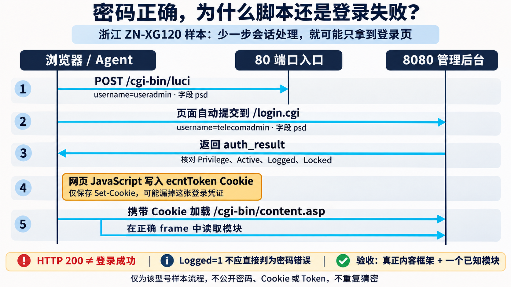

# 02：浏览器能登录，脚本为什么总说密码错

[返回首页](../README.md)

## 先把结论说清

**浏览器使用同一份密码能登录，而脚本失败时，先查流程，不要先怀疑密码。**

常见漏项有：

- 端口；
- 提交地址；
- `psd` 和 `password` 这类字段差别；
- 登录成功页中还要执行的下一步；
- 浏览器自动写入的 Cookie；
- 页面所在的 frame；
- `User-Agent` 和 `Referer`；
- 已有会话占用；
- 管理请求被代理送到了另一条路径。

Cookie 可以理解成“登录后发给浏览器的小票”。没有带对小票，服务器就会把后续请求当成陌生人。

## 一、浙江 ZN-XG120 样本的真实流程

下面是**这个样本**的流程，不代表所有光猫。



```text
打开 80 端口的 LuCI 登录页
        |
向 /cgi-bin/luci 提交：
username=useradmin
psd=从安全存储读取的超密
        |
返回页自动再向 8080 端口提交：
POST /login.cgi
username=telecomadmin
psd=同一份超密
        |
返回一页包含 auth_result 的 HTML
        |
网页 JavaScript 把 ecntToken 写成 Cookie
        |
进入 /cgi-bin/content.asp
        |
在 content.asp 的框架内加载各个模块
```

最容易漏的是中间两步：

1. 不是向 `check_auth.json` 用 `password=` 随便一投就算登录。
2. `ecntToken` 可能不是服务器用 `Set-Cookie` 响应头下发，而是网页脚本自己写进去。

因此，**只有 curl 的 cookie jar，并不等于已经收齐全部登录凭据。**

cookie jar 就是工具保存登录小票的文件。它通常会记录服务器正式下发的小票，但不会替你执行网页 JavaScript。

### 已知流程时可以直接走第二段

在这个固件上，已经知道完整过程后，可以直接：

```text
POST http://192.168.1.1:8080/login.cgi
Content-Type: application/x-www-form-urlencoded

username=telecomadmin&psd=从安全存储读取的超密
```

这是协议示意，不是让你把真实密码粘到 URL、命令历史或公开文档里。

请求还要保留本机验证过的浏览器标识和来源信息。不要关闭证书校验、绕到公网或更改全局代理来碰运气；这里示例本身是设备提供的本地 HTTP 管理口。

### 返回 200 不是登录成功

样本返回页里有类似结构：

```json
{
  "Locked": "0",
  "Logged": "0",
  "Privilege": "1",
  "Active": "1",
  "Luci": "1",
  "ecntToken": "REDACTED_SESSION_TOKEN"
}
```

上面是脱敏示意，不是真实会话。

| 字段 | 本样本里怎么理解 |
|---|---|
| `Locked` | 是否处于登录锁定状态 |
| `Logged` | 是否有会话占用等状态，必须结合页面分支解释 |
| `Privilege` | 本次是否获得对应权限 |
| `Active` | 当前认证流程是否处于可继续的状态 |
| `ecntToken` | 后续请求使用的会话票据，绝不能公开 |

成功时看到的是 `Privilege=1/2` 且 `Active=1`，之后还要验证真正的内容页能打开。

**`Logged=1, Privilege=0` 不应该被直接翻译成“密码错误”。** 这次就遇到过维护账号已经处于登录状态。

### 登录成功后的下一步

1. 在内存中取出 `auth_result.ecntToken`。
2. 把它作为 `ecntToken` Cookie 发回光猫。
3. 保留同一套 cookie jar、浏览器标识和来源页。
4. 先加载 `/cgi-bin/content.asp`。
5. 再在对应框架上下文中读取子页面。

不要把整个返回页、请求头或者令牌打印进 Agent 日志。

### 为什么直接打开子页面又跳回去了

可能是：

- 没有 token；
- token 已过期；
- 忘了带 JavaScript 设置的 Cookie；
- 没有先建立内容框架；
- 来源信息不同；
- 当前用户不具备该模块权限；
- 固件根本不提供这个模块；
- 站点或设备访问路径错误。

**一次 302 跳转不能证明“没有这个功能”。** 先把会话和框架复现正确，再判断权限或模块支持。

## 二、上海中兴 G7615V2 样本

本样本使用：

```text
POST http://192.168.1.1:8080/login.cgi

username=telecomadmin
psd=从安全存储读取的超密
```

成功后：

```text
HTTP 302
Location: /start.ghtml
Cookie: SID=已脱敏
```

之后的页面结构是：

```text
start.ghtml
  ├─ top.gch
  └─ template.gch
       └─ getpage.gch?pid=1002&nextpage=某模块.gch
```

例如，本样本的设备信息页和时间页属于这个页面集合。

这里依然要保持会话和框架来源。不要拿某个其他型号的 `pid`、`nextpage` 或 CGI 名字去穷举当前设备。

### 80 端口的登录页为什么容易误导

本样本 80 端口显示的是另一层天翼网关登录界面，脚本可能把用户名改写为 `useradmin`。你在界面里输入的内容，不一定就是最终发送给后台的内容。

正确做法是：

1. 先看实际表单；
2. 看提交前的 JavaScript；
3. 看返回后有没有自动提交；
4. 看最终建立会话的请求；
5. 用一次完整会话验证内容页。

不是“看着像登录页，就向它 POST 一次”。

## 三、怎样让 Agent 检查登录，又不泄露密码

可以直接给它这段要求：

> 已确认这份超密能在浏览器登录。请先复现完整表单、跳转、Cookie 和 frame 流程。密码从本地安全存储读取，不写进命令字面量，不放进 URL，不打印请求正文、Cookie 或 Token。失败时只报告 HTTP 状态、认证状态字段和失败阶段，不输出密码或响应全文。不要换密码，不要试默认口令表，不要反复登录积累锁定次数。

如果需要检查传输中有没有变化，只比较：

- 本地和远端的值是否一致；
- 在内存里算出的摘要是否一致；
- 是否意外多了换行、BOM 或编码转换。

只输出 `matches=True/False` 一类结果。**不要为了证明密码没变，把它完整打印出来。**

## 四、已有会话怎么办

优先顺序：

1. 使用你已经获准使用的现有会话；
2. 等待旧会话自然过期；
3. 确有必要，再在得到许可后通过设备正式支持的方式终止旧会话。

不要：

- 为了挤掉一个登录，重启整个光猫；
- 恢复出厂；
- 重置超级密码；
- 反复提交错误登录；
- 无故把可复用的 cookie jar 删掉。

案例里后来再登录就成功了，并没有必要强行“踢人”。

## 五、登录完成的验收标准

下面五项都满足，才继续读配置：

- [ ] 已确认访问的是目标站点的目标光猫；
- [ ] 认证状态与成功分支吻合；
- [ ] 真正的内容框架可读；
- [ ] 一个确定存在的模块可读，且内容不是登录页或空壳；
- [ ] 会话资料安全保留，没有进入公开日志。

登录成功和“页面修改能提交”还不是同一件事。加密表单和校验字段放在 [04：安全修改](04-change-settings.md) 讲。
