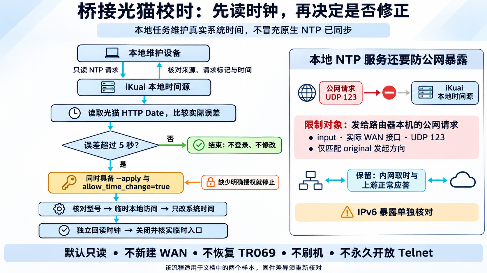

# 05：桥接后光猫一直是 1970 年，怎样真正修好时间

[返回首页](../README.md)



上图表示程序执行顺序，所有读取动作均由本地维护设备发起，不表示 iKuai 会替你读取光猫。先完成普通检查，确需强制验证修复路径时才另用 `--force`。

## 本章目录

- [先分清三个时钟](#先分清三个时钟)
- [先试原生对时，不要上来就开命令行](#先试原生对时不要上来就开命令行)
- [让 iKuai 当本地时间服务器](#让-ikuai-当本地时间服务器)
- [别把对时服务暴露给公网](#别把对时服务暴露给公网)
- [原生对时不工作时的替代方案](#原生对时不工作时的替代方案)
- [两个样本的临时命令访问差别](#两个样本的临时命令访问差别)
- [参考脚本怎么用](#参考脚本怎么用)
- [怎样设置自动执行](#怎样设置自动执行)
- [怎样验收才算完成](#怎样验收才算完成)
- [什么时候应当停止](#什么时候应当停止)

## 先分清三个时钟

你的网络里至少有：

1. 光猫的系统时间；
2. iKuai 的系统时间；
3. 运行 Agent 或脚本那台电脑/旁路由的系统时间。

其中一个正确，不代表另外两个正确。

NTP 就是一种网络取时方式，可以理解为“向一台可靠设备问现在几点”。默认使用 UDP 123 端口。

本方案里：

```text
可靠的上游时间源
       |
     iKuai
       |
  本地维护设备取时
       |
必要时修正光猫系统时间
```

不是把光猫的时间抄到路由器，也不是用光猫的错误时间去校准整张网。

### 时间错会影响什么

最直接的是光猫自己的日志时间不准，排查事件时对不上时间。

不要进一步保证“校时就能解决所有断网、降速或光路问题”。某些固件可能有时间相关缺陷，但必须有对应证据，不能把网上的猜测当作当前设备已经证实的故障。

## 先试原生对时，不要上来就开命令行

如果光猫本来就能正常从允许的时间源同步，**到这里就可以停，不必部署本章脚本**。

先读：

- 当前时间和时区；
- 自动对时是否开启；
- 时间服务器；
- 所选接口或业务类型；
- 是否真的有对应的路由模式 WAN；
- 运行一段时间后，真实系统时间是否变正确。

两台样本中，接口选项都是 INTERNET、VOICE、TR069、OTHER 一类 **WAN 业务类型**，而不是“光猫本地 LAN 管理口”。

当只剩桥接 WAN 后，把服务器填写成 `192.168.1.2`，虽然能保存，原生客户端仍然没有正常同步。

### 这里最容易误判

> 路由器上测试 `192.168.1.2` 能回应，所以肯定是光猫被防火墙拦住了。

这个结论跳了一步。

你首先应该确认光猫有没有发请求：

1. 看相关时间进程是否运行；
2. 如果有明确授权，做范围很小、时长和大小都有限制的抓包；
3. 确认抓的是正确接口、正确方向、正确地址和端口；
4. 覆盖一次明确触发的对时周期；
5. 把“没有发出”和“发了但没回应”分开。

浙江样本当时没有运行的 NTP 进程；在已确认的接口和采样窗口内，过滤光猫到本地时间源的 UDP 123，没有捕获到请求。抓包文件只有 24 字节头部。

**单独一个空抓包不是万能结论。** 过滤器、接口和时间窗口必须先确认，结合进程、页面和配置才能判断。

### 不要把校时命令当成只读测试

某些 `ntpd -q`、`ntpclient -s` 用法会改变运行它的那台设备的时间。

如果你只是想问服务器几点，用只发送一个 NTP 请求并读取回应的工具，不要顺手校准生产路由器。

## 让 iKuai 当本地时间服务器

案例用的常见管理网段示意：

```text
光猫：192.168.1.1
iKuai 光猫侧管理地址：192.168.1.2
```

先确认这些地址在你现场真实存在，尤其不要把 PPPoE 公网地址改成这个私有地址。

在 iKuai 中核对：

- iKuai 自己的时间准确；
- 时区正确；
- 自动向可靠上游同步正常；
- 本地 NTP 服务确实启用；
- 本地维护设备能够取到有效回应。

本次使用的上游例子是 `ntp1.aliyun.com`。这只是可选时间源，不是要求所有人必须使用同一家。

如果用 API，要先读取整条当前配置，预览要改的字段，写入后再整条回读。不要发一个没核实合并行为的残缺对象，把无关配置覆盖掉。

### `listenport` 不是 NTP 监听接口

这是本次确实踩过的坑。

iKuai 基本配置里的 `listenport`，在样本前端中属于 DPI/透明模式相关设置，不是 NTP 服务绑定接口。

不要因为名字像“监听接口”，就改成 `lan1,wan1`。不要凭字段名字猜功能。

误改过的应恢复原值，并验证其他设置没有变化。

## 别把对时服务暴露给公网

本次开启本地服务后，从外部网络检查发现，公网 UDP 123 也会回应。

所以“局域网能取时”还不是验收结束。你可能无意中开成了一个公共时间服务器。

### 样本采用的限制

仅阻止从实际公网拨号接口进入、发给路由器自身的 NTP 请求：

```text
方向：input（进路由器本机）
协议：UDP
目的端口：123
进接口：实际公网拨号接口
连接方向匹配：original / 原始
动作：drop
```

“原始”是指这条连接的发起方向。

这样做的目的是：

- 阻止外部用户主动来问你家路由器几点；
- 不去阻止你家路由器向上游问时间之后收到的正常答复。

这是样本固件上验证过的策略，不是说所有设备的状态匹配和处理顺序完全相同。

### 使用 ikuai-cli 时的预览示意

先按该工具当前说明，安全配置你自己的认证。不要把 API Token 写进命令文本。

```sh
ikuai-cli security acl create \
  --name ntplocal \
  --action drop \
  --protocol udp \
  --direction input \
  --in-interface REPLACE_WITH_YOUR_PPPOE_INTERFACE \
  --dst-port 123 \
  --priority 10 \
  --enabled no \
  --data '{"ctdir":1}' \
  --dry-run --format json
```

上面只是**不执行写入的预览**，接口名必须替换为你现场核实的值。

注意：

1. 样本后端使用 `input`，有版本的 CLI 帮助却写 `in`，不要盲从缩写。
2. `ctdir=1` 在这个版本里表示原始方向，`2` 表示应答，`0` 表示不限制。
3. 不要把原有转发 ACL 改成这条规则。
4. 不要照抄样本的规则编号，创建后重新读取实际 ID。
5. 可以先创建为禁用，核对无误后再明确启用。
6. 样本 API 曾拒绝带空格的备注，因此最终规则备注留空，名称使用简单字母。
7. 样本 WAN IPv6 当时关闭。**你的 IPv6 若开启，必须一并核对 IPv6 暴露，不能只挡 IPv4 就说全部安全。**

### 限制后必须从两个方向验证

- 内网：维护设备仍能从 iKuai 取时；
- 路由器：自己的上游同步不受影响；
- 外网：由你有权使用的另一网络发出的 NTP 请求不能再得到服务；
- 业务：上网、拨号、原有转发不受影响。

不要仅从路由器里面访问自己的公网 IP，便声称完成了外网验证。

## 原生对时不工作时的替代方案

两个样本最后没有为了校时重新添加 TR069 管理通道，也没有新增第二个上网连接。

采用的是本地维护设备主动校准：

```text
定时任务开始
    |
向本地 iKuai 发送 NTP 请求
    |
核对来源、回应类型、时间和请求标记
    |
读光猫 HTTP 系统时钟
    |
误差不大 -> 直接结束，不登录、不改设置
    |
误差较大 -> 使用已授权的临时本地命令访问
    |
只设置光猫系统时间
    |
用命令行时间和 HTTP 时间再次核对
    |
关闭本次临时访问
```

本仓库默认误差阈值为 5 秒。HTTP 时间通常只显示到秒，最终约一秒的误差没有必要当成新故障。

### 这不是让光猫本机原生 NTP 突然“好了”

原生同步状态可能仍显示未同步，但系统时间已经正确，由外部本地任务维护。

报告应写：

> 光猫实际系统时间已校准，后续由本地任务检查和修正。

不要伪造一个“原生 NTP 已同步”的结论。

## 两个样本的临时命令访问差别

### 上海中兴：先辨认当前协议代际

这个样本返回的是 `webFac v3`，握手特征是 `re_rand=`。

不要把它当成：

- 空返回的旧 v1；
- `newrand=` 的 v2；
- 网上任何一个“中兴都能用”的万能脚本。

公开整理版只实现本次采用的 v3 路径，且先验证当前机型。协议来源见 [第三方说明](../THIRD_PARTY_NOTICES.md)。

前提仍是你已经持有合法取得的当前超密。这里只使用临时命令访问，**不固化 Telnet、不刷写任何分区、不改 MAC、不改光路身份、不重启**。

协议里的“复位认证状态机”和“临时工厂认证”，不是恢复出厂，但它们也不是普通只读页面访问，必须属于已批准的临时访问方案。不要因为看到了 `Factory` 或 `reset` 字样就随便执行别的同名操作。

`re_rand` 回应还可能带着设备 MAC 等信息。调试时也不要把原始握手响应公开，本工具不会把它们打印出来。

如果隔着 iKuai 做源地址转换，光猫实际看到的二层来源可能是 iKuai 光猫侧接口，不是你桌面电脑网卡。不能把电脑 MAC 或网上给的“神奇 MAC”硬填进去。

脚本从光猫当前主机表中寻找管理地址对应的记录。读不到、与现场不符或验证失败，就停，不会自动改网卡去迁就工具。

### 浙江 ZNXT：Web 登录、Telnet 登录和提权是几回事

Web 超密不是 Telnet 密码的同义词。

需要先在明确授权下取得该设备自己的本地命令访问凭据；本次是在已授权的超级管理会话内，仅在内存中读取现有配置对应字段，存入安全存储，没有保存整份配置备份到仓库。

公开脚本不包含默认 Telnet 密码，也不替你猜这些值。

这个固件还有一个容易绕远路的细节：

- Telnet 登录使用 LF 换行；
- 发送 CRLF 会被当成多次提交，可能产生一个空密码尝试；
- 登录后还可能需要 `su` 提权；
- 上海样本的登录换行和提示符又不一样。

不要看到一次 `Error!` 就开始更换密码、做密码字典或关闭安全软件。

### 这些不是公网安全通道

本地 HTTP 和 Telnet 不能当成 SSH 或可靠的端到端加密通道。协议中的加密封装也不等于给整个管理过程加上了安全传输。

只在可信本地网络中使用；远程时先进入你已有的安全管理通道，再在站点内执行。**不要把光猫的 23、80、8080 端口转发到公网来迁就脚本。**

### 临时入口一定要核对关闭

- ZNXT：重读 `telnetenable_flag=No`，并检查是否还有真实的 Telnet 响应。
- 中兴：临时服务可能叫 `telnetd` 或 `utelnetd`，只关掉一个名字不一定够。
- 如果原本就有用户自己的 Telnet 服务，不要接管，更不要用 `killall` 顺手把别人的会话全杀掉。
- 清理失败必须报告，不能只因时间变正确就写“全部成功”。

普通 TCP 握手成功不一定可靠。透明代理可能先完成握手，而目标实际不可达；应结合真实协议响应或设备端状态判断。

## 参考脚本怎么用

先说明验证边界：**实际样本使用的原型已验证；公开整理版增加了显式授权、模型核对、默认只读和日志脱敏，只完成静态检查，未再次拿生产设备测试。**

不要跳过代码审查和本机条件核对。

### 1. 核对运行环境

目标是你已有的 Linux / OpenWrt / ImmortalWrt 管理设备，需要 Python 3、curl、OpenSSL 和脚本使用的标准库。

Windows 可运行 `--help`、离线 `--check-config` 和默认只读检查，前提是所需的 Python 3 和 curl 已经可用。**实际写时间只支持 Linux / OpenWrt**，文件锁只在写入阶段加载。Windows 用户通过已有安全管理通道，在站点内的 Linux 管理设备上执行写入，不把光猫端口转发到公网。

检查依赖不等于允许自动升级、换源或安装一堆软件。缺什么就明确列出来，按你的授权处理，不要照抄一条 `curl | sh`。

### 2. 准备私密运行配置

复制与你样本相符的模板，在你自己的设备上填写真实值：

- [clock-zte.example.json](../examples/clock-zte.example.json)
- [clock-znxt.example.json](../examples/clock-znxt.example.json)

示意操作，必须在你自己的 Linux 管理设备和合适目录里执行：

```sh
umask 077
cp clock-zte.example.json /etc/ont-clock.local.json
chmod 600 /etc/ont-clock.local.json
```

用本地安全编辑器或凭据管理工具填写，不把真实值放进命令字面量，不提交这个 `.local.json`。

配置中的 `allow_time_change` 默认是 `false`。只有你明确确认脚本、机型、路径和风险后，才在本机改成 `true`。

模板中的 `REPLACE_...` 不是有效密码，不能拿它去试登录。

### 3. 先只检查

先做完全不联网的配置检查：

```sh
python3 ont-clock.py /etc/ont-clock.local.json --check-config
```

它只报告结构、占位符和本机依赖是否就绪，不输出密码，不验证凭据真伪，也不证明路由或型号正确。在 Windows 中把 `python3` 换为你已安装的 `python`。

确认目标和路径后，下面这条才会发起只读网络请求：

```sh
python3 ont-clock.py /etc/ont-clock.local.json
```

默认只做两件事：向指定本地时间源取时，读光猫 HTTP 时钟。**不会登录后台，不会打开命令通道，不会校时。**

默认只读阶段不使用 Web 密码。没有响应的命令端口不能当成“已经关闭”，实际修复遇到端口状态不明会停止，不接管已有服务。

它证明的是“运行脚本的设备能取时、能读目标 HTTP 时钟”，不证明光猫自己的原生 NTP 能用。

### 4. 明确授权后才修正时间

```sh
python3 ont-clock.py /etc/ont-clock.local.json --apply
```

还要同时满足配置中允许写时间、型号与当前设备吻合、凭据有效等检查。

只有需要明确验证修复路径、且你接受再次设置当前正确时间时，才用：

```sh
python3 ont-clock.py /etc/ont-clock.local.json --apply --force
```

不要把光猫故意设回 1970 年来做测试，也不要未经授权重启整台设备来演示自动恢复。

## 怎样设置自动执行

先满足以下条件：

- 前台运行过一次明确授权的修复；
- 实际时钟已读回；
- 临时入口已关闭；
- 本地 NTP 和公网访问限制已验证；
- 本机私密配置是 600；
- 原有定时任务已经读过；
- 没有重复同一任务。

再把**一条**任务加到你自己的调度系统，不覆盖原有任务表。

示例：

```cron
*/5 * * * * /usr/bin/python3 /usr/bin/ont-clock.py /etc/ont-clock.local.json --apply 2>&1 | logger -t ont-clock
```

含义是每五分钟检查一次，超过允许偏差才校准，而不是每五分钟强制登录和设置时间。

脚本使用文件锁，避免手动执行和定时执行重叠。

普通重启后，任务会在本地管理路径和准确时间源都恢复后再次尝试。系统重装或固件升级是否保留文件，要另外按你的保留策略确认；脚本不会替你创建备份或上传配置。

## 怎样验收才算完成

不要只看“设置保存成功”。至少核对：

1. 光猫真实时间和时区正确；
2. 命令行时间与 HTTP / 页面时间一致；
3. 多次实际定时执行留下成功记录；
4. 每次误差有明确单位；
5. 日志不含凭据和唯一标识；
6. 临时命令入口已关闭；
7. 原有拨号、桥接和上网没有变化；
8. 公网不能把你的设备当公共 NTP 服务使用。

日志示意，不是原始记录：

```text
example-a CHECK ntp=192.168.1.2 offset=-0.7s changed=no
example-b APPLY verified offset=0.4s temporary_access=closed
```

HTTP 时间只有秒级精度，还带请求延迟，不应宣称由此证明了毫秒级同步。

## 什么时候应当停止

- 没有有效超密或没有明确授权；
- 不能确认访问的是哪台光猫；
- 机型不匹配；
- 握手协议不是已支持的版本；
- 本地 NTP 时间源本身不可信或与管理设备差别太大；
- 设备已有不属于本脚本的命令会话；
- 需要新建 WAN、改 MAC、刷机、改光路身份才能继续；
- 临时入口无法确认关闭。

停止时报告具体限制，不要为了“必须完成”越权扩大范围。
