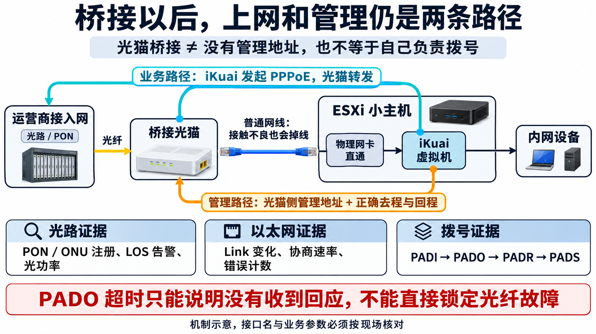
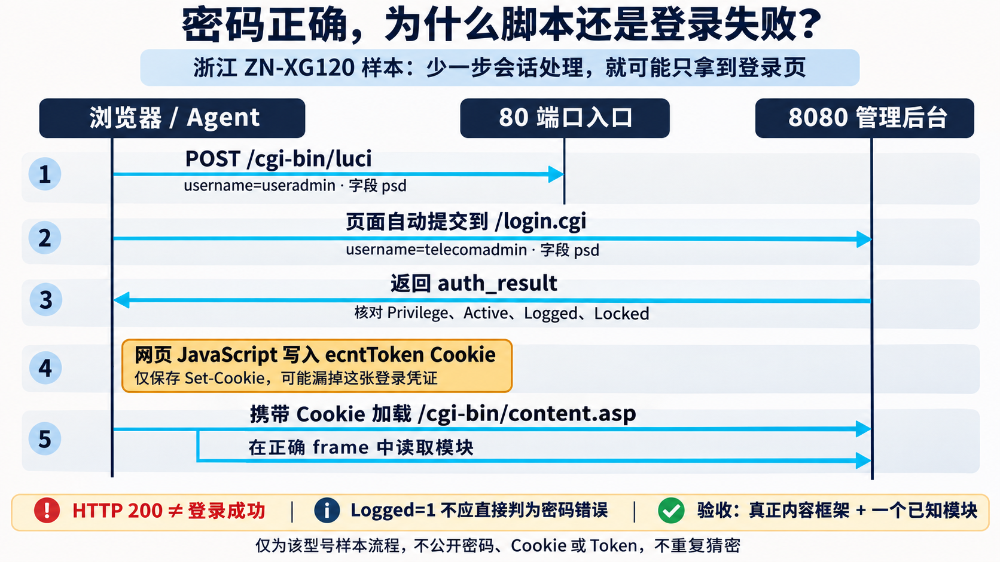
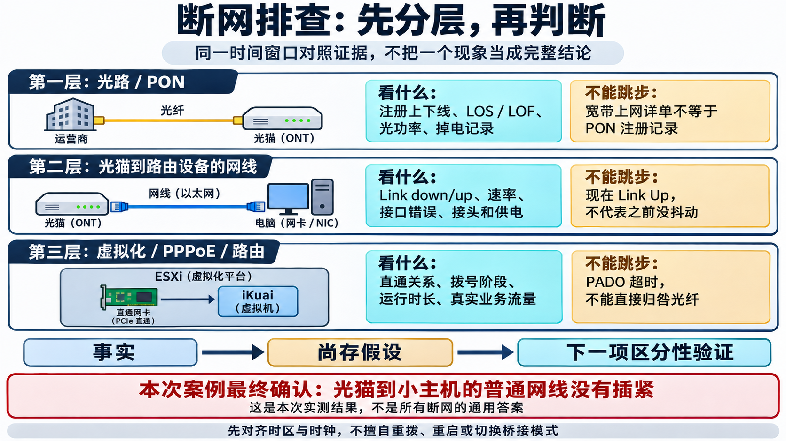
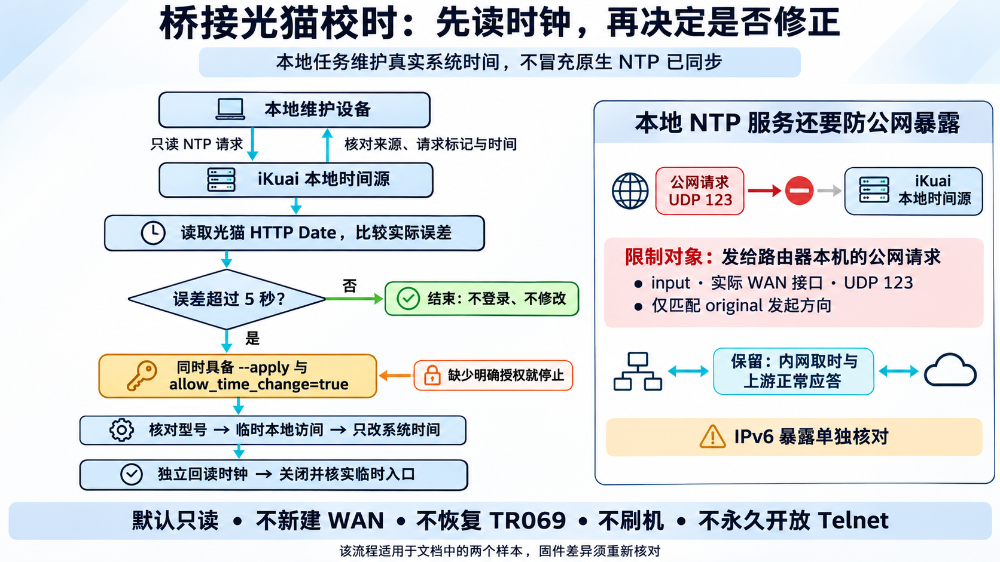

# 电信光猫维护工具包：图解、Skill、离线手册和可填写模板

这一版不再只给一个需要自己翻目录的仓库：**下载、解压，就有入门入口、可安装的 Skill、可直接填写的记录表和离线图文手册。**

> **第一前提：向负责这条宽带的装维师傅取得当前光猫有效的超级管理员账号和密码。只维护本人或已明确授权的设备。没有超密不猜密、不刷机、不改光路身份。**

## 先选你需要的附件

| 下载 | 里面有什么 | 下载后怎么用 |
|---|---|---|
| **[完整维护工具包 ZIP](https://github.com/lazyalex616/china-telecom-ont-guide/releases/download/v1.0.0/telecom-ont-toolkit-v1.0.0.zip)** | 全套中文文档、四张技术图、单文件离线手册、Skill、模板、安装器与校时参考源码 | 解压后先读 `START-HERE.md`，不用自己拼目录 |
| **[轻量 Agent Skill 包 ZIP](https://github.com/lazyalex616/china-telecom-ont-guide/releases/download/v1.0.0/telecom-ont-agent-kit-v1.0.0.zip)** | 同一 Skill、完整参考资料、启动提示词、三份记录表、离线安装器 | 在解压目录先预览安装，确认后再复制 |
| **[可导入的 .skill 文件](https://github.com/lazyalex616/china-telecom-ont-guide/releases/download/v1.0.0/telecom-ont-maintenance.skill)** | 保留完整目录的 ZIP 格式 Skill | 仅在平台支持导入时使用，它不是可执行程序 |
| **[单文件中文离线手册 HTML](https://github.com/lazyalex616/china-telecom-ont-guide/releases/download/v1.0.0/telecom-ont-handbook-v1.0.0.html)** | 文档、插图、表格和样式放在一个文件内 | 下载后用普通浏览器打开，不需要 Python、Git 或本地服务 |
| [SHA256 校验表](https://github.com/lazyalex616/china-telecom-ont-guide/releases/download/v1.0.0/SHA256SUMS.txt) | 前面四个下载文件的摘要 | 与下载文件的完整 SHA256 比较，它不是数字签名 |

不需要全部下载。第一次用选完整包，只装 Skill 选轻量包，只阅读选 HTML。GitHub 自动生成的 Source code 是源码快照，不是上面的成品包。

## 中文技术图 1：桥接后，业务和管理是两条逻辑路径



图里真正负责拨号的是 iKuai，光猫负责桥接转发。本地管理还需要正确的光猫侧管理地址、去程和回程。两个用途可能共用同一根网线，但不能用“管理 ping 通”证明全部桥接业务一直正常。

这里还标出 `PADI → PADO → PADR → PADS`：**PADO 超时只是拨号发现阶段没收到回应，不是光纤损坏的专用错误码。**

## 中文技术图 2：为什么密码正确，脚本仍会登录失败



浙江 ZN-XG120 样本不只是“向一个地址 POST 密码”：它有两段提交、认证状态分支、网页 JavaScript 设置的 `ecntToken`，以及后面的内容框架。

**只保存 Set-Cookie 可能漏凭证，HTTP 200 不等于登录成功，`Logged=1` 也不该直接解释成密码错。** 这是具体固件样本的流程，不是万能登录器。

## 中文技术图 3：断网证据怎么分层，才不会越查越偏



把光路/PON、普通以太网、虚拟化与拨号分开看。上网会话详单不是 ONU/PON 注册记录，ESXi 管理网卡也不能代替直通给 iKuai 的另一块网卡。

本次实际故障最终是**光猫到小主机的普通网线没有插牢**。教程保留了错误判断和纠正过程，但不把这个结果推广为所有断网的答案。

## 中文技术图 4：自动校时为什么还要核对公网防护



这张是程序执行顺序，不是网络拓扑，所有读取都由本地维护设备执行：先问可靠本地时间源，再读光猫 HTTP 时钟。误差不大，不登录、不修改。

普通修复同时要求 `--apply` 和本机 `allow_time_change=true`，只改系统时间，随后独立回读并核实临时入口关闭。额外的 `--force` 只供明确要求验证修复路径时使用。

同时，本地 NTP 服务还要限制真正公网接口进入、发给路由器本机的 UDP 123 请求，避免无意变成公共时间服务器。保留内网取时和上游正常应答，IPv6 单独核对。

## Skill 包不是几句空提示词

它包含完整的 `SKILL.md`、三份技术参考、一份只读启动提示词和三份可填写的工作表：

- **只读模块盘点表**：逐页面、逐现有 WAN/SSID/线路记录覆盖情况与未确认项。
- **变更验收表**：明确目标、业务影响、保留项，以及提交前和独立回读后的值。
- **断网证据表**：把同一时间窗口的事实、仍存假设和下一项区分性验证分开。

在解压后的包目录，先预览：

```sh
python tools/install-skill.py
```

确认安装目录适用于你的 Agent 后，再明确复制：

```sh
python tools/install-skill.py --apply
```

Linux / macOS 的命令可能叫 `python3`。安装器只需要 Python 3.9+ 和标准库，不联网、不安装依赖、不改 Agent 配置、不覆盖已有 Skill。其他平台先核实目录，再用 `--target` 指定 Skills 父目录。

**Skill 本身不是独立运行的程序，也不提供浏览器、SSH、权限或密码。** Agent 仍需使用你已经授权的管理工具，安装 Skill 不等于授权修改设备。

## 参考工具补齐了实际使用入口

- `ont-clock.py --help`：不联网，先看用法。
- `--check-config`：离线检查 JSON 结构、占位符和依赖，不打印密码。
- 默认模式：只取 NTP 和 HTTP 时钟，不登录后台。
- `--apply`：只支持 Linux / OpenWrt，还要通过本机授权和目标核对。
- Windows 不再在加载文件锁模块时直接失败，可做离线检查和只读读取。
- HTTP 的 GMT 时间按 UTC 解读，避免受执行设备的夏令时影响。
- 命令端口超时是“未知”，不冒充“已关闭”；已有或不明入口不接管。
- ZNXT 关闭临时入口后，会再独立读取一次开关。

这不是全型号一键修复程序。先核对型号、固件、地址和管理路径，再决定是否采用。

## 适用样本与不能省略的限制

| 案例来源 | 型号 | 当时读取的软件版本 |
|---|---|---|
| 上海电信 | 中兴 ZXHN G7615V2 | `V3.0.0P1T2` |
| 浙江电信 | ZNXT ZN-XG120 | `ZV2.01.X01` |

不同省份、业务、硬件和固件必须重新读取，不能照抄 VLAN、连接编号或接口名。删 TR069 不等于永久消除所有运营商管理能力，低档防火墙不是通用安全推荐。

四张图由 GPT 画图工具生成，实际均为 **1672 × 941**，并人工核对了中文和关键机制。它们不是生产截图，也没有引入真实身份、密码或票据。

历史原型在两个案例中验证过；**本次公开版只完成语法、配置、链接、打包和隐私等静态检查，没有重新连接生产设备，没有运行安装器或设备行为测试。** 离线手册没有脚本、跟踪或自动联网资源，但手动点击线上代码与下载链接仍需联网。

[仓库首页](https://github.com/lazyalex616/china-telecom-ont-guide) · [入门与安装说明](https://github.com/lazyalex616/china-telecom-ont-guide/blob/v1.0.0/START-HERE.md) · [完整校时章节](https://github.com/lazyalex616/china-telecom-ont-guide/blob/v1.0.0/docs/05-time-sync.md) · [图解文字说明](https://github.com/lazyalex616/china-telecom-ont-guide/blob/v1.0.0/assets/figures/README.md)
